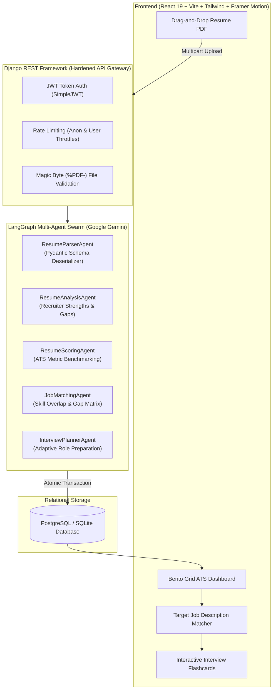

# 🚀 Agentic Resume AI

<div align="center">

[](https://python.org)
[](https://djangoproject.com)
[](https://langchain.com)
[](https://ai.google.dev)
[](https://react.dev)
[](https://tailwindcss.com)
[](LICENSE)

**An enterprise-grade, multi-agent AI system for intelligent resume evaluation, ATS readiness scoring, skill gap analysis, and tailored interview coaching.**

[Explore Architecture](#-system-architecture) • [Security Hardening](#-security-hardening--ecc-gate) • [Quickstart](#-quickstart) • [Detailed Notes](NOTES.md)

</div>

---

## 🌟 Overview

**Agentic Resume AI** transforms static resume screening into an autonomous, multi-agent evaluation pipeline. Built on **Django REST Framework**, **LangGraph**, and **Google Gemini**, the platform ingests resume PDFs, extracts and validates structured biographical data, simulates executive recruiter feedback, computes an objective ATS readiness score, and builds personalized interview preparation flashcards.

Coupled with a **luxury obsidian dark-mode React frontend** (Framer Motion, Bento Grid, React Bits craft), it eliminates generic AI slop in favor of high information density and instant recruiter insights.

---

## 🧠 System Architecture



---

## 🛡️ Security Hardening & ECC Gate

This codebase incorporates rigorous security fixes over standard prototype implementations:

* **File Signature Verification:** `ResumeUploadSerializer` inspects binary magic bytes (`b"%PDF-"`) to prevent malicious executables and decompression bombs.
* **Prompt Injection Defense:** Untrusted extracted document text is isolated inside `<candidate_resume_untrusted>` XML boundaries with strict instructions forbidding the model from executing user commands.
* **Environment-Isolated Secrets:** Zero hardcoded keys. `SECRET_KEY`, `DEBUG`, and database credentials are dynamically resolved via `.env`.
* **Database ACID Safety:** Multi-table AI result persistence is wrapped inside `@transaction.atomic` to prevent partial or orphaned records.
* **API Throttling:** Configured DRF throttling (`AnonRateThrottle` & `UserRateThrottle`) protects Gemini API quotas from abuse.

---

## 💻 Tech Stack

| Domain | Technologies |
| :--- | :--- |
| **Backend Framework** | Python 3.11+, Django 5/6, Django REST Framework |
| **Authentication** | `djangorestframework-simplejwt` (Stateless JWT) |
| **Multi-Agent Orchestration** | `langgraph` (StateGraph), `langchain-google-genai` (Google Gemini) |
| **Data Contracts** | `pydantic` v2, `email-validator` |
| **Document Processing** | `pymupdf` (fitz native text extraction), `pytesseract` (OCR) |
| **Database** | PostgreSQL (`psycopg2`) with seamless SQLite (`db.sqlite3`) local fallback |
| **Frontend Framework** | React 19, Vite, Tailwind CSS v4, Lucide React, Canvas Confetti |

---

## ⚡ Quickstart

### 1. Clone & Setup Workspace
```powershell
git clone https://github.com/Bhavesh-Tirgar/Agentic-Resume-AI.git
cd Agentic-Resume-AI
```

### 2. Run Backend (Django REST Framework)
```powershell
cd ResumeAI

# Setup environment
copy .env.example .env

# Run database migrations
python manage.py makemigrations
python manage.py migrate

# Start backend server
python manage.py runserver 8000
```
Backend API will be active at: `http://localhost:8000`

### 3. Run Frontend (React 19 + Vite)
```powershell
cd ../frontend

# Install dependencies
npm install

# Start development server
npm run dev
```
Frontend interface will open at: `http://localhost:5173`

---

## 🧪 Automated Testing

Run the test suite covering authentication, file upload security, and mocked agent graphs:
```powershell
cd ResumeAI
python manage.py test
```

---

## 📄 License & Attribution
Distributed under the MIT License. Developed with pride by [Bhavesh Tirgar](https://github.com/Bhavesh-Tirgar).
