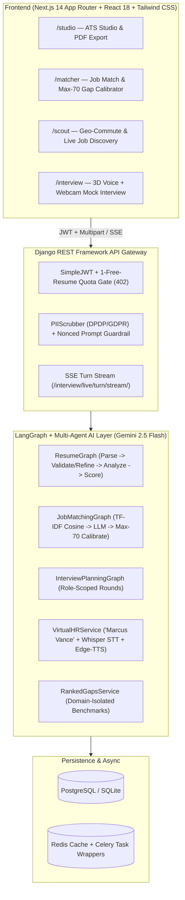

# CareerPilot — Agentic Resume AI

<div align="center">

[](https://python.org)
[](https://www.django-rest-framework.org)
[](https://nextjs.org)
[](https://langchain-ai.github.io/langgraph/)
[](https://ai.google.dev)
[](#-verification--quality-gates)

**An enterprise-grade, multi-agent AI career platform for ATS resume auditing, deterministic job matching, skill-gap roadmapping, and real-time voice + vision mock interviews.**

[Architecture](#-system-architecture) • [Agents & Services](#-agents--orchestration-inventory) • [ATS Scoring](#-how-ats--job-matching-work) • [Tech Stack](#-tech-stack) • [Quickstart](#-quickstart)

</div>

---

## System Architecture



---

## Agents & Orchestration Inventory

CareerPilot uses **6 specialized LLM Agents** (all inheriting [`BaseAgent`](file:///C:/Users/DELL/.gemini/antigravity/scratch/bhavesh/ResumeAI/AI/Agents/BaseAgent.py) with structured Pydantic outputs and PII redaction), **3 LangGraph StateGraphs**, and **4 Multimodal/Aggregation Services**:

### 1. Core LLM Agents (`ResumeAI/AI/Agents/`)
| # | Agent | Responsibility |
|---|---|---|
| 1 | `ResumeParserAgent` | Extracts structured `ResumeSchema` (skills, experience, education, summary) from raw PDF/DOCX/OCR text |
| 2 | `ResumeAnalysisAgent` | Audits strengths, weaknesses, and bullet-level improvements |
| 3 | `ResumeScoringAgent` | Scores 6 universal ATS dimensions (`overall`, `ats_compatibility`, `format`, `keywords`, `content`, `readability`) |
| 4 | `JobMatchingAgent` | Evaluates 3-tier skill alignment (`Exact`, `Adjacent`, `Missing`) against a target JD |
| 5 | `JobDiscoveryAgent` | Ranks discovered jobs with role/domain relevance and commute context |
| 6 | `InterviewPlannerAgent` | Generates multi-round technical + behavioral interview plans scoped to a resume & job match |

### 2. LangGraph Workflows (`ResumeAI/AI/Graphs/`)
- **`ResumeGraph`**: `parse_resume` → `validate_parse` → (self-corrects once via `refine_parse` if sparse) → `analyze_resume` → `score_resume`
- **`JobMatchingGraph`**: `compute_vector_similarity_node` (TF-IDF cosine + keyword gaps) → `match_job_node` (Gemini) → `calibrate_match_node` (deterministic Max-70 Hard Cap)
- **`InterviewPlanningGraph`**: Generates structured interview rounds persisted per `(resume, job_match_id)`

### 3. Specialized Multimodal & Domain Engines (`ResumeAI/AI/Services/` & `Utils/`)
- **`VirtualHRService` ("Marcus Vance")**: Adaptive multi-round interviewer with rolling history compression, boundary-safe profanity detection, SSE streaming (`VirtualHRTurnStreamView`), and deterministic heuristic fallback if LLM/TTS is offline.
- **`WhisperAudioService`**: Speech-to-text via `faster-whisper` with semaphore concurrency control, 15MB ceiling, and optional GPU offload (`WHISPER_REMOTE_URL`).
- **`RealVoiceService`**: Neural TTS via `edge-tts` (`en-US-ChristopherNeural`) with LRU audio cache and hard timeout degradation.
- **`CandidateVisionService` + `CameraFeedHUD`**: Browser hardware `FaceDetector` API + YCbCr/NormRGB skin chromaticity & bilateral eye-band validation (with wall-rejection guard).
- **`UnifiedDossierService`**: Single-shot Gemini dossier synthesis (12k char cap, nonced prompts, recursive PII restoration).
- **`RankedGapsService`**: Aggregates skill gaps across jobs and real interview weaknesses with strict domain isolation (Finance/Sales/Healthcare never leak DevOps skills).
- **`GeoCommuteEngine`**: Global city centroids + Haversine distance + optional cached OSRM road routing (`USE_REAL_OSRM_ROUTING`).

---

## How ATS & Job Matching Work

1. **Standalone Resume ATS Score (`/studio`)**:
   Evaluates 6 dimensions (`0–100`): `overall`, `ats_compatibility`, `format`, `keywords`, `content`, and `readability` across both technical and non-technical domains.
2. **Job-Specific Match Score (`/matcher`)**:
   - **3-Tier Matching (`SkillAliasTable`)**: Exact (`1.0`), Adjacent (`0.6`), Missing (`0.0`).
   - **Evidence Weighting**: Proven in work/project bullets (`1.0×`) vs. skills-list only (`0.6×`).
   - **Composite Formula**: `0.60 × MustHave + 0.20 × NiceToHave + 0.10 × ExpFit + 0.10 × LocFit`.
   - **Max-70 Hard Cap**: Deterministically caps `overall_match_score <= 70` whenever any must-have skill is missing.

---

## Security, Privacy & Freemium Quota

- **Prompt Injection Defense (`PromptInjectionGuardrail`)**: Cryptographically random per-request XML nonces (`<untrusted_candidate_resume_...>`) + base64/leetspeak/tag-breakout detection.
- **DPDP (India) & GDPR Compliance (`PIIScrubber`, `Authentication/views.py`)**: Scrubs emails, obfuscated `[at]` emails, phones, and PIN/ZIP codes before LLM calls, recursively restores them locally via `restore_recursive()`, and provides O(1) data export (`/api/auth/privacy/export-data/`) and physical file shredding erasure (`/api/auth/privacy/delete-account/`).
- **1-Free-Resume Quota Gate (`UserResumeQuota`)**:
  - 1st completed resume scan is **free** (persisted per user so deleting the 1st resume does not reset free quota).
  - Subsequent uploads return **`HTTP 402 Payment Required`** (`QUOTA_EXCEEDED`) before running PDF/OCR extraction.
  - `/api/auth/quota/order/` & `/api/auth/quota/verify/` integrate **Razorpay Checkout** (`RAZORPAY_KEY_ID`, `RAZORPAY_KEY_SECRET`) with HMAC-SHA256 signature verification, `PaymentTransaction` replay protection (`409 Conflict`), and local dev sandbox fallback (`DEBUG=True` / `ALLOW_SANDBOX_TOPUP=True`).

---

## Tech Stack

| Layer | Technologies |
|---|---|
| **Frontend** | Next.js `14.2.24`, React `18.3`, TypeScript `5.5`, Tailwind CSS `3.4`, Framer Motion `11`, Lucide Icons, `jsPDF` |
| **Backend** | Python `3.11`, Django, Django REST Framework, SimpleJWT, Gunicorn (`2×4` workers) |
| **AI & ML** | LangGraph, LangChain, Google Gemini `2.5 Flash`, `faster-whisper`, `edge-tts`, PyMuPDF + Tesseract OCR |
| **Infra & CI** | PostgreSQL, Redis, Celery task wrappers, Docker & `docker-compose.yml`, GitHub Actions (`.github/workflows/ci.yml`) |

---

## Quickstart

### 1. Backend (`ResumeAI/`)
```bash
cd ResumeAI
python -m venv venv
venv\Scripts\activate          # Windows (or source venv/bin/activate on Linux/macOS)
pip install -r requirements.txt
copy .env.example .env         # Add GEMINI_API_KEY
python manage.py migrate
python manage.py runserver 127.0.0.1:8000
```

### 2. Frontend (`resume-ai-next/`)
```bash
cd resume-ai-next
npm install
npm run dev                    # Runs on http://localhost:3000
```

### 3. Docker Fullstack
```bash
docker compose --profile fullstack up --build
```

---

## Verification & Quality Gates

| Gate | Command | Status |
|---|---|---|
| Django System Check | `python manage.py check` | `0 issues` |
| Django Unit & API Suite | `python manage.py test` | `40/40 OK` |
| Golden LLM Security & Rubric Eval | `python manage.py run_llm_eval` | `5/5 PASS` |
| Next.js Production Build | `npm run build` | `Exit 0 (9 static routes)` |
| Headless Chrome CDP E2E | `node e2e/smoke.mjs` | `4/4 routes` |
